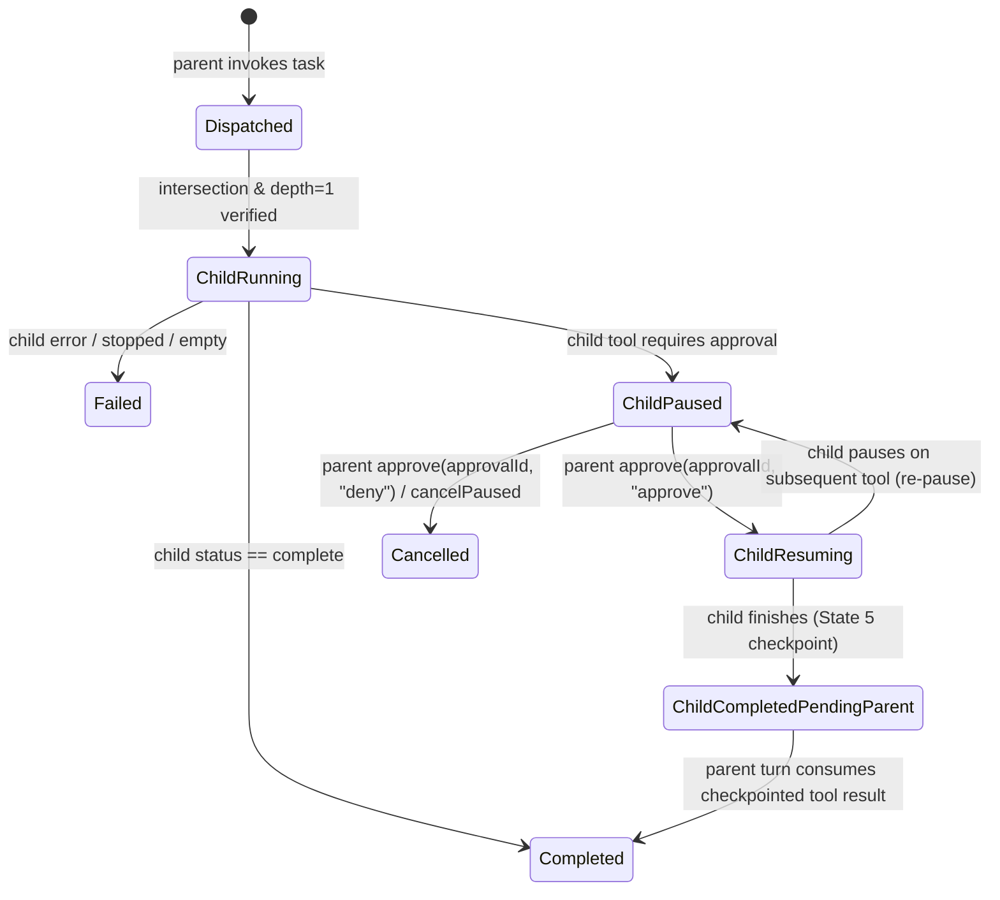

# v1.18.0 运行能力闭环设计规格（R18-01 至 R18-04）

- **类型**：后端 spec（as-built）
- **日期**：2026-10-23
- **版本**：v1.18.0
- **关联**：[R18-01 总预算与取消契约](2026-10-07-v1.18-r18-01-aggregate-budget-contract.md) · [C-Durable 跨进程编排恢复](2026-06-27-v3-phase-c-durable-orchestration-recovery-design.md) · [v1.18.0 实施计划与收口摘要](../../plans/backend/2026-10-23-v1.18.0-runtime-closure.md) · [审计补救台账](2026-07-12-agent-findings-remediation.md)

---

## 1. 背景与目标

在 v1.17.0 之前，运行时存在三处尚未闭环的边界：
1. **编排总预算未按真实出站调用汇总**：`orchestration.budget` 仅在轮次边界做静态读取，Router、Planner、Worker（含内部 verify/repair 与子委派）、Reviewer、Replan、Synthesizer 与后台 Experience 蒸馏未共享同一请求级预算与全树取消作用域。
2. **内置 `task` 工具仅返回排队占位文本**：`src/tools/builtin/task.js` 返回 `"Sub-agent task queued..."` 占位字符串，未真正创建受限子 Worker 执行并返回真实结果，也缺少父子审批暂停与跨进程恢复归属。
3. **`repair` 路径缺少有界 tool-call 语法纠正**：主执行循环（`executor-loop.js`）已支持 `maxToolCallRepairs`，但验证失败后的修复执行器（`repair-executor.js`）在模型输出畸形 JSON 或非法 tool-call 结构时直接失败，无有界语法重试。

**v1.18.0 目标**：在不触发 `agent-runtime.js` 大规模结构重写（审计台账 `#10` 阶段 3–4 继续保持延期至 `v2.0`）的前提下，完成上述三项运行能力闭环，并补齐工作区信任/SSRF/Electron 导航安全加固。

---

## 2. R18-01：请求级聚合预算、全树取消与恢复续扣

详细契约见 [`2026-10-07-v1.18-r18-01-aggregate-budget-contract.md`](2026-10-07-v1.18-r18-01-aggregate-budget-contract.md)。核心要点：

- **`RequestBudget` 与 `RequestScope`**（[`src/core/runtime/request-budget.js`](../../../src/core/runtime/request-budget.js)）：
  - 在 `routedSend` 入口创建请求级 `rootBudget` 与 `baseScope`；模型档 `router` 调用即纳入同一 `executionId` 记账。
  - 当路由至 `orchestrate` 泳道时，继承该账本并经 `scope.bindGateway(modelGateway, { role, subtaskId })` 覆盖 `router`、`planner`、`worker`、`reviewer`、`replan`、`synthesizer`、`task`、`experience` 全角色；当路由至 `single` 泳道时，不挂载编排总预算，保持普通单代理多轮工具循环不受干扰。
  - 三阶段原子记账：`reserveCall`（出站前并发原子预留调用名额与估算 token）→ `markStarted`（物理 HTTP 发起前扣减 `model_calls`，网络失败不退还）→ `settle`（按 `attemptId` 幂等结算真实 usage，缺失/非法 usage 计入 `unknownUsageAttempts` 与 `unknownUsageTokens` 保底负债）。
- **语义边界声明**：
  - `model_calls` 与 `tokens` 是运行护栏与配额控制指标，**不等同于云端精确财务账单**；未知 usage 采用保守保底占额（`max(fallbackTokensPerUnknown, estimatedTokens)`）防止无限透支。
  - 跨进程恢复仅保证在**显式审批暂停检查点**（sidecar 已落盘）精确续扣与续跑，不承诺任意网络崩溃点的分布式 `exactly-once`。

---

## 3. R18-02：真实 `task` 子任务委派、父子审批与持久化恢复

### 3.1 权能交集与防递归护栏（[`task-delegation-contract.js`](../../../src/core/orchestration/task-delegation-contract.js)）

- **参数契约**：`prompt` 必填非空字符串；`tools` 可选字符串数组，最多 `MAX_TASK_TOOLS = 5` 项，拒绝非字符串、空串、重复项、未知工具与递归工具（`task`、`ask_user`），不做静默截断。
- **有效工具集计算（交集收窄）**：
  $$\text{effectiveTools} = (\text{requestedTools} \cup \text{defaultReadonly}) \cap \text{parentAllowedTools} \cap \text{profileAllowedTools} \setminus \{\text{task}, \text{ask\_user}\}$$
  - 若父上下文不具备某写工具权限（如只读父任务请求 `edit` 或 `shell`），直接返回 `status: "denied"`（`TASK_TOOL_ESCALATION_DENIED`），零副作用。
- **深度限制（`MAX_TASK_DELEGATION_DEPTH = 1`）**：
  - 子 Worker 的工具 schema 列表剥离 `task` 与 `ask_user`；
  - 执行层通过 `context.taskDelegationDepth >= 1` 双重拦截伪造的 `task` 调用（`TASK_RECURSION_DENIED`），杜绝孙任务与无限递归。

### 3.2 父子状态机与审批暂停（[`task-delegation-service.js`](../../../src/core/orchestration/task-delegation-service.js)）

- **两级独立授权**：批准父回合外层 `task` 工具调用**绝不**自动批准子 Worker 内部的受控写工具（如 `edit`、`shell`）；子写工具触发 `awaiting_approval` 时，携带真实子工具审批摘要与 `approval.id` 向上冒泡使父回合暂停。
- **续跑与二次暂停（Case B）**：
  - 批准子审批时，父回合通过 `taskDelegationResume` 定位子 Worker 的 `pending_tool_call` 精确续跑，**不重新派发整个 `task`**，已完成的前置工具不重复执行。
  - 若子 Worker 续跑后命中第二个需审批工具，消费旧 `approvalId`、生成新 `approvalId` 并更新父子关联，保留父回合剩余工具队列（`remaining_tool_calls`）。
- **预算与取消共享**：子 Worker 共享父回合局部 `CostBudget`（双向同步增量）与编排 `RequestScope`（以 `role: "task"` 记账）；父回合 `interrupt()`、超时或 `kernel.dispose()` 立即中止在途子 Worker。

### 3.3 跨进程持久化与幂等边界（[`task-paused-persistence.js`](../../../src/core/recovery/task-paused-persistence.js)）

- **Sidecar 存储**：`recovery.enabled = true` 时，子 Worker 暂停状态写入 `.deepseek-code/v2/sessions/<projectId>/task-paused/<approvalId>.json`（`schemaVersion = 1`，含 `fingerprints`、`task_id`、`parent_turn_id`、`parent_tool_call_id`、`session_id`、脱敏后的 `child_record` 与 `state`）。
- **启动交叉校验（[`recovery-service.js`](../../../src/core/recovery/recovery-service.js)）**：
  - 父 `paused/<approvalId>.json` 含 `resume_state.task_delegation` 时，必须存在匹配的 `task-paused/<approvalId>.json`，且 `schemaVersion`、`fingerprints`、`approvalId`、`taskId`、`parentTurnId`、`parentToolCallId`、`sessionId` 全量吻合。
  - 孤儿父记录、孤儿子记录、损坏 JSON 或版本/指纹不匹配一律标记为 `blocked_recovery` 并移入隔离或原样保留证据，**绝不降级为无主单 Worker 恢复或自动重派**。
- **故障注入与 State 5 检查点幂等**：
  - 子 Worker 恢复执行期间先落盘 `state: "child_resuming"`；若在完成检查点前崩溃，重启扫描见到 `state === "child_resuming"` 无法证明写操作是否已完成，明确阻断自动恢复（`task child crashed mid-resume before completion checkpoint`），防止重复写入。
  - 子 Worker 完成后先落盘 `state: "child_completed_pending_parent"`（State 5 检查点，含脱敏限长后的 `completed_tool_result`），再交由父回合继续；若在父回合消费前崩溃，恢复时直接向父回合回灌已保存的 `completed_tool_result`，子写操作严格只执行一次。

---

## 4. R18-03：`repair` 路径的有界 tool-call 语法修复

### 4.1 双层计数严格分离

| 配置项 | 作用域 | 语义 |
|---|---|---|
| `maxRepairAttempts` | `repair-loop.js` | 验证（测试）失败后最多执行几轮修复循环（既有能力） |
| `maxToolCallRepairs` | `executor-loop.js` + `repair-executor.js` | 单次模型响应的 tool-call JSON 解析失败或结构畸形时，在产生任何工具副作用前最多额外请求几次语法纠正（v1.18.0 补齐 `repair` 路径） |

- 默认 `maxToolCallRepairs = 0`（或未配置）时保持旧行为，畸形 tool-call 直接报错退出，不额外发起模型调用。

### 4.2 整批预校验与有界纠正循环（[`repair-executor.js`](../../../src/core/execution/repair-executor.js)）

1. **三阶段严格切分**：`模型调用 → 整批 tool-call 语法/结构预校验（validateRepairToolCallsBatch） → 顺序执行工具`。
2. **零前置副作用保证**：只要批次中任意一项存在 `arguments_parse_error`、非对象参数、缺失工具名或批次内重复 `tool_call.id`，**整批拒绝执行**（即使排在前面的工具调用语法合法且为写操作，也绝不先执行）。
3. **错误分类边界**：仅模型输出本身的 tool-call 语法/结构错误触发纠正重试；工具权限拒绝（`denied`）、未知工具名、工具 schema 业务参数校验失败、文件冲突、网络认证错误、预算耗尽或取消**不进入**语法重试。
4. **回灌与协议保持**：重试时保留有效 assistant 消息的 `reasoning_content`（满足 DeepSeek thinking 历史回传协议），对错误原因执行 `redactSecrets` 脱敏与长度截断，并发出 `model:tool_call_repair` 事件。
5. **暂停与跨进程恢复**：当语法纠正成功后的工具批次中某工具触发 `awaiting_approval` 时，`resume_state` 与 `repair_context` 完整持久化已规范化的剩余批次、已完成工具结果及累计 `tool_call_repairs` / `prior_tool_call_repairs` 计数；批准恢复后从 pending 工具继续，不重做已完成工具、不重置语法重试配额。

---

## 5. 安全加固（Security Remediation）

随 v1.18.0 一并落地的三项纵深防御修复：
1. **未受信工作区 MCP 持久化授权隔离**（[`src/index.js`](../../../src/index.js)、[`src/tools/mcp/tool-policy.js`](../../../src/tools/mcp/tool-policy.js)）：当 `workspaceTrusted === false` 时，拒绝授予 `project` / `always` 持久化审批作用域（强制降级为 `session`），且不加载工作区本地 `.deepseek-code/mcp-policy.json`，阻断恶意仓库预置策略自动放行。
2. **多记录 DNS 固定与 SSRF 防护**（[`src/security/ssrf.js`](../../../src/security/ssrf.js)）：`createPinnedLookup` 支持 `options.all === true`（Node `http`/`https` Happy Eyeballs 路径），返回全部已校验的安全地址列表，确保多 A/AAAA 记录场景下无未校验 IP 漏出。
3. **Electron 渲染层导航锁死**（[`gui/main.js`](../../../gui/main.js)）：在 `will-navigate` 与 `setWindowOpenHandler` 上拦截非本地应用入口的外部跳转，防止渲染层被诱导导航至外部不可信 URL。
